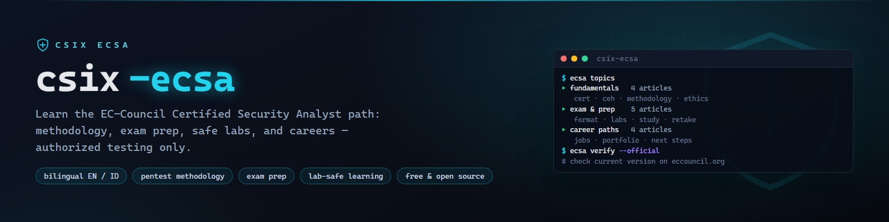

# csix-ecsa



**Basis belajar ECSA gratis dua bahasa (EN/ID) — apa itu sertifikasi EC-Council Certified Security Analyst, metodologi penetration testing, persiapan ujian, lab aman, dan jalur karier. Hanya untuk pengujian berizin.**

[](https://github.com/siedysoes/csix-ecsa/actions/workflows/ci.yml)
[](LICENSE)
[](https://siedysoes.github.io/csix-ecsa/)
[](https://www.eccouncil.org/)

`csix-ecsa` adalah basis pengetahuan terstruktur dan ramah pemula tentang
jalur sertifikasi ECSA (EC-Council Certified Security Analyst). Situs ini
menjelaskan kredensial tersebut, perbandingannya dengan CEH dan sertifikasi
keamanan ofensif lain, alur kerja penetration testing secara konseptual,
persiapan ujian, lab latihan yang aman, dan pilihan karier yang realistis.

> ⚠️ **Sumber belajar independen.** EC-Council, CEH, ECSA dan LPT adalah
> merek dagang pemiliknya. Proyek ini **tidak resmi** dan **tidak berafiliasi
> atau didukung oleh EC-Council**. Tidak ada materi kursus resmi, kunci jawaban
> ujian, atau konten berhak cipta di sini. Versi sertifikasi, format ujian,
> syarat, harga, dan kebijakan perpanjangan/CPD dapat berubah — **verifikasi
> semuanya di [eccouncil.org](https://www.eccouncil.org/)**.
>
> 🛡️ **Hanya pengujian berizin.** Seluruh materi metodologi bersifat edukatif
> dan mengasumsikan Anda berlatih di lab milik sendiri atau sistem yang
> memiliki izin tertulis eksplisit untuk diuji. Tidak ada kode exploit,
> payload, teknik evasion, atau instruksi menyerang sistem tanpa izin.

> 🌐 **Baca di web:** **https://siedysoes.github.io/csix-ecsa/**

## Isi

### Fundamental (4 artikel)

| Artikel | Yang akan Anda pelajari |
|---------|-------------------------|
| [Apa Itu ECSA](id/fundamentals/what-is-ecsa.md) | Kredensial, posisi dalam keluarga EC-Council, siapa yang cocok |
| [ECSA vs CEH & Sertifikasi Lain](id/fundamentals/ecsa-vs-ceh.md) | Jalur analyst vs hacker, LPT, OSCP, GPEN — beda fokus |
| [Metodologi Penetration Testing](id/fundamentals/pentest-methodology.md) | Tahapan uji berizin, dari penentuan lingkup sampai pelaporan |
| [Lingkup, Otorisasi & Etika](id/fundamentals/scope-and-ethics.md) | Aturan main, izin tertulis, syarat berhenti, privasi |

### Ujian & Persiapan (5 artikel)

| Artikel | Yang akan Anda pelajari |
|---------|-------------------------|
| [Format Ujian & Versi ECSA](id/exam/exam-format.md) | Cara cek versi/format terkini di eccouncil.org |
| [Pelatihan, Lab & Range Latihan](id/exam/training-and-labs.md) | Pelatihan resmi vs belajar mandiri, opsi lab aman |
| [Rencana Belajar Praktis](id/exam/study-plan.md) | Rutinitas belajar berbasis catatan, lab, dan latihan laporan |
| [Hari Ujian & Aturan Ulang](id/exam/exam-day.md) | Persiapan dan logistik; selalu verifikasi kebijakan terkini |
| [Biaya, Masa Berlaku & CPD](id/exam/cost-validity.md) | Komponen biaya, perpanjangan, dan catatan pendidikan lanjutan |

### Jalur Karier (4 artikel)

| Artikel | Yang akan Anda pelajari |
|---------|-------------------------|
| [Karier Setelah ECSA](id/career/ecsa-careers.md) | Peran pentester, security analyst, manajemen kerentanan |
| [Membangun Portofolio yang Aman](id/career/portfolio.md) | Tulisan lab dan laporan yang menunjukkan skill tanpa merugikan orang |
| [Sertifikasi & Skill Berikutnya](id/career/next-steps.md) | Langkah lanjutan dan skill blue-team yang saling melengkapi |
| [Skill, Rekrutmen & Realita Lapangan](id/career/reality-check.md) | Apa yang dicari employer; verifikasi data pasar kerja terkini |

Setiap artikel tersedia dalam **English** (`en/`) dan **Bahasa Indonesia** (`id/`).

## Baca di web

Situsnya adalah aplikasi statis satu halaman (tanpa server, tanpa pelacakan)
yang dijalankan GitHub Pages — merender file Markdown dari repo ini secara langsung:

- 🌐 **https://siedysoes.github.io/csix-ecsa/**
- Tombol ganti bahasa **EN ↔ ID** di bar atas
- Kotak pencarian memfilter topik saat Anda mengetik
- Link di dalam artikel navigasi tanpa reload halaman

## Struktur repositori

```
csix-ecsa/
├── index.html        # cangkang aplikasi web
├── app.js            # router + pencarian + ganti bahasa
├── style.css         # tema gelap
├── topics.json       # manifest topik (judul + jalur, EN/ID)
├── assets/           # banner
├── en/               # artikel English
│   ├── fundamentals/
│   ├── exam/
│   └── career/
├── id/               # artikel Indonesia
│   ├── fundamentals/
│   ├── exam/
│   └── career/
└── .github/workflows # CI: validasi link + manifest
```

## Berkontribusi

1. Fork, lalu tambah/ubah Markdown di `en/` (dan terjemahkan di `id/`).
2. Daftarkan topik baru di `topics.json` (kedua bahasa).
3. Buka pull request — CI memastikan semua link dan entri manifest valid.

Gaya artikel: Markdown murni, tanpa front matter, baris pertama `# Judul`,
diakhiri satu bagian `## Lihat juga` berisi link relatif.

## Bahasa

- [English](README.md)
- Bahasa Indonesia (file ini)

## Lisensi

MIT — lihat [LICENSE](LICENSE). Konten bebas dipelajari, dibagikan, dan
diadaptasi dengan atribusi. ECSA dan EC-Council adalah merek dagang
pemiliknya; proyek ini sumber belajar independen tidak resmi. Berlatih hanya
dengan izin.
