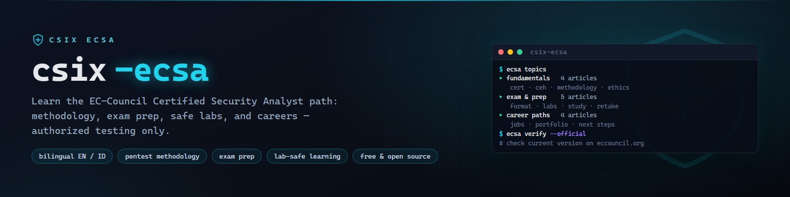

# csix-ecsa



**Free bilingual (EN/ID) ECSA learning base — what the EC-Council Certified Security Analyst credential is, penetration testing methodology, exam preparation, safe labs, and career paths. Authorized testing only.**

[](https://github.com/siedysoes/csix-ecsa/actions/workflows/ci.yml)
[](LICENSE)
[](https://siedysoes.github.io/csix-ecsa/)
[](https://www.eccouncil.org/)

`csix-ecsa` is a structured, beginner-friendly knowledge base about the ECSA
(EC-Council Certified Security Analyst) certification path. It explains the
credential, how it compares with CEH and other offensive-security
certifications, the penetration testing workflow at a conceptual level, exam
preparation, safe practice labs, and realistic career options.

> ⚠️ **Independent study resource.** EC-Council, CEH, ECSA and LPT are
> trademarks of their respective owners. This project is **unofficial** and
> **not affiliated with or endorsed by EC-Council**. It contains no official
> course materials, exam dumps, or copyrighted content. Certification
> versions, exam format, eligibility rules, prices, and renewal/CPD policies
> change — **verify everything on [eccouncil.org](https://www.eccouncil.org/)
> and [cert.eccouncil.org](https://cert.eccouncil.org/)**.
>
> 📌 **Status note (checked 26 Nov 2026):** ECSA is not listed in EC-Council's
> current certification catalogue. The official
> [Retired Certifications](https://cert.eccouncil.org/retired-certification.html)
> page lists ECSA v9 (14 Sep 2018) and ECSA (Practical) (15 May 2021). This
> site teaches the still-useful VAPT methodology as a **historical path**; it
> does not claim a current exam, version, or entitlement.
>
> 🛡️ **Authorized testing only.** All methodology content is educational and
> assumes you are practicing in a lab you own or a system you have explicit
> written permission to test. No exploit code, payloads, evasion techniques,
> or instructions for attacking systems without authorization are provided.

> 🌐 **Read it on the web:** **https://siedysoes.github.io/csix-ecsa/**

## What's inside

### Fundamentals (4 articles)

| Article | You'll learn |
|---------|--------------|
| [What Is ECSA](en/fundamentals/what-is-ecsa.md) | The credential, its place in the EC-Council family, who it suits |
| [ECSA vs CEH & Other Certs](en/fundamentals/ecsa-vs-ceh.md) | Analyst vs hacker tracks, LPT, OSCP, GPEN — differences in focus |
| [Penetration Testing Methodology](en/fundamentals/pentest-methodology.md) | Phases of an authorized test, from scoping to reporting |
| [Scope, Authorization & Ethics](en/fundamentals/scope-and-ethics.md) | Rules of engagement, written permission, stop conditions, privacy |

### Exam & Preparation (5 articles)

| Article | You'll learn |
|---------|--------------|
| [ECSA Exam Format & Versions](en/exam/exam-format.md) | How to check the current version/format on eccouncil.org |
| [Training, Labs & Practice Range](en/exam/training-and-labs.md) | Official training vs self-study, safe lab options |
| [A Practical Study Plan](en/exam/study-plan.md) | A study routine built on notes, labs, and reporting practice |
| [Exam Day & Retake Rules](en/exam/exam-day.md) | Preparation and logistics; always verify current policies |
| [Costs, Validity & CPD](en/exam/cost-validity.md) | Fee components, renewal and continuing education caveats |

### Career Paths (4 articles)

| Article | You'll learn |
|---------|--------------|
| [Careers After ECSA](en/career/ecsa-careers.md) | Pentester, security analyst, vulnerability management roles |
| [Building a Safe Portfolio](en/career/portfolio.md) | Lab write-ups and reports that show skill without harming anyone |
| [Next Certifications & Skills](en/career/next-steps.md) | Logical next steps and adjacent blue-team skills |
| [Skills, Hiring & Reality Check](en/career/reality-check.md) | What employers actually look for; verify current job market data |

Every article exists in **English** (`en/`) and **Indonesian** (`id/`).

Each of the 26 articles is a full study guide (4,200+ words) with learning
objectives, comparison tables, decision diagrams, fictional worked cases,
scenario exercises with answer keys, reusable checklists, a glossary, and
source-verification notes — not a shallow summary.

## Read on the web

The site is a static single-page app (no server, no tracking) served by
GitHub Pages — it renders the Markdown files from this repo live:

- 🌐 **https://siedysoes.github.io/csix-ecsa/**
- Language toggle **EN ↔ ID** in the top bar
- Search box filters topics as you type
- In-article links navigate without page reloads

## Repository layout

```
csix-ecsa/
├── index.html        # web app shell
├── app.js            # router + search + language toggle
├── style.css         # dark theme
├── topics.json       # topic manifest (titles + paths, EN/ID)
├── assets/           # banner
├── en/               # English articles
│   ├── fundamentals/
│   ├── exam/
│   └── career/
├── id/               # Indonesian articles
│   ├── fundamentals/
│   ├── exam/
│   └── career/
└── .github/workflows # CI: link + manifest validation
```

## Contribute

1. Fork and add/edit Markdown under `en/` (and translate under `id/`).
2. Register new topics in `topics.json` (both languages).
3. Open a pull request — CI checks that all links and manifest entries resolve.

Article style: pure Markdown, no front matter, `# Title` first line,
one `## See also` section with relative links at the end.

## Languages

- English (this file)
- [Bahasa Indonesia](README.id.md)

## License

MIT — see [LICENSE](LICENSE). Content is free to learn from, share, and adapt
with attribution. ECSA and EC-Council are trademarks of their owners; this
project is an independent, unofficial study resource. Practice only with
authorization.
